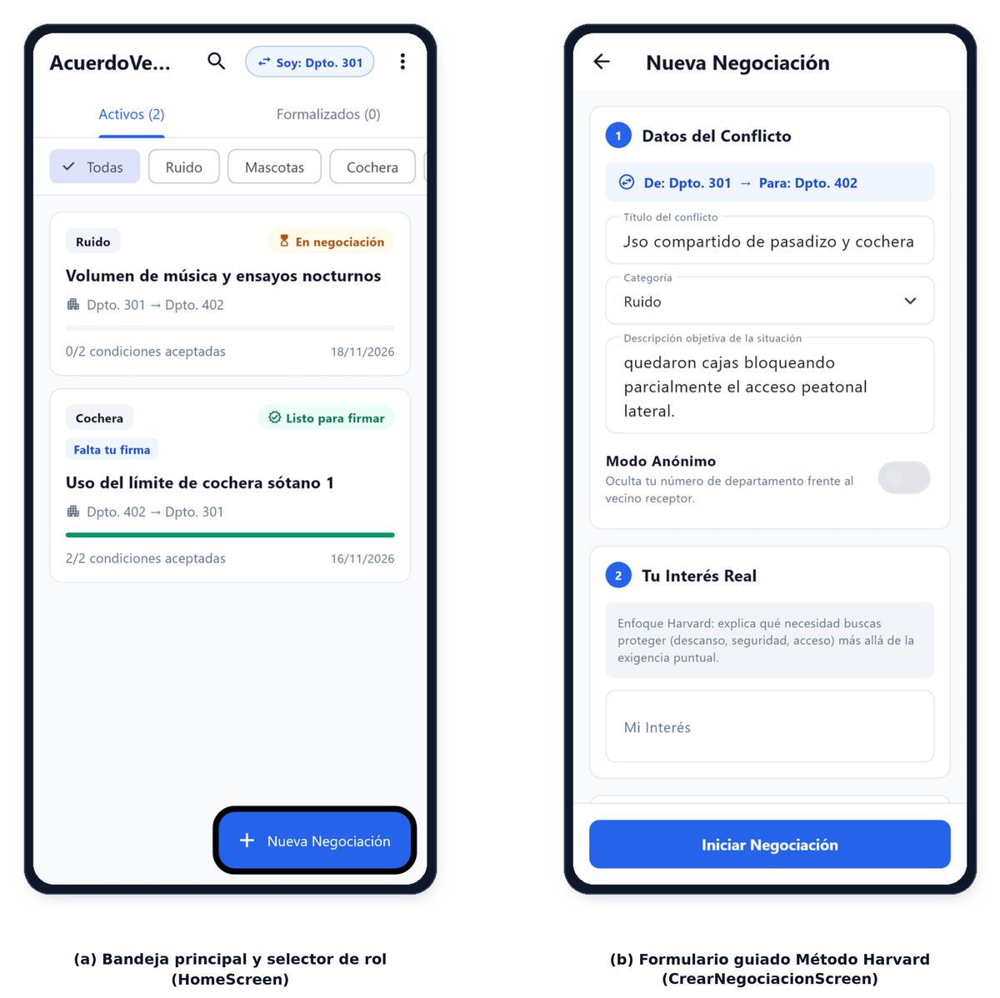
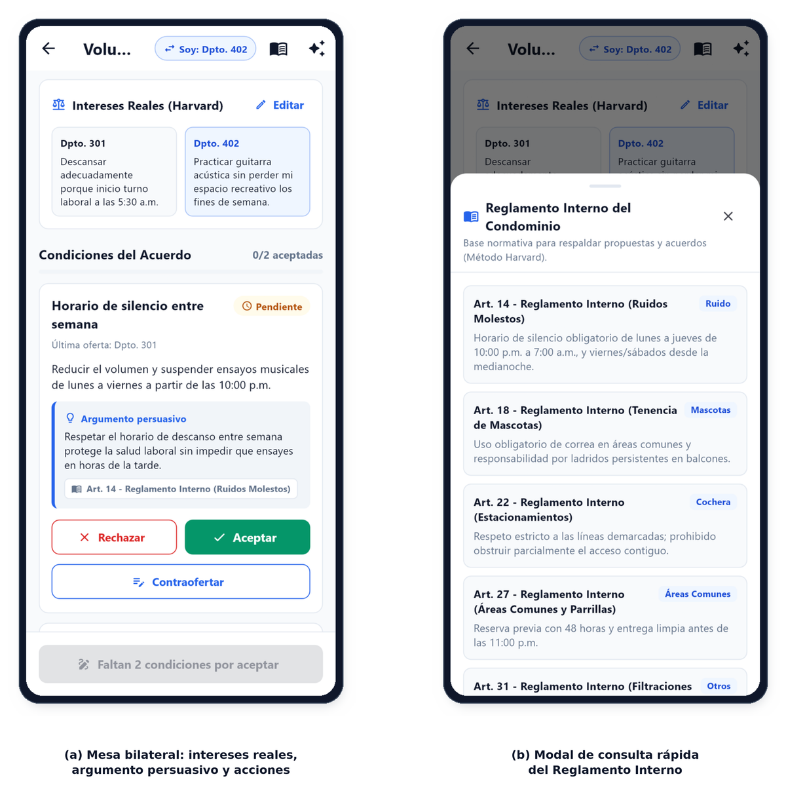
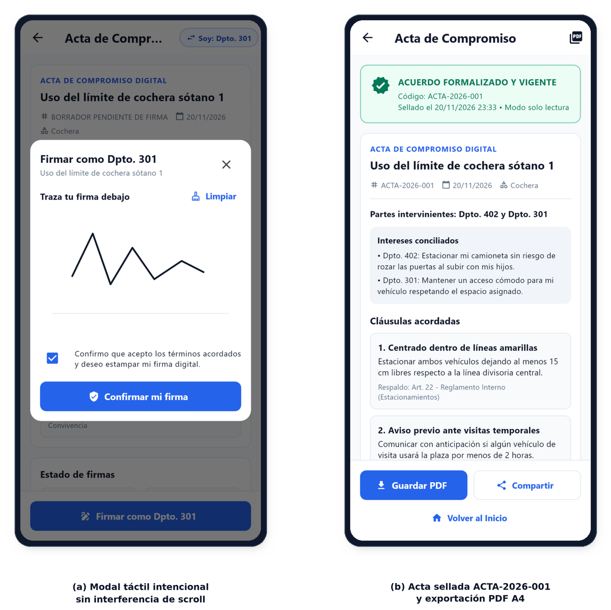
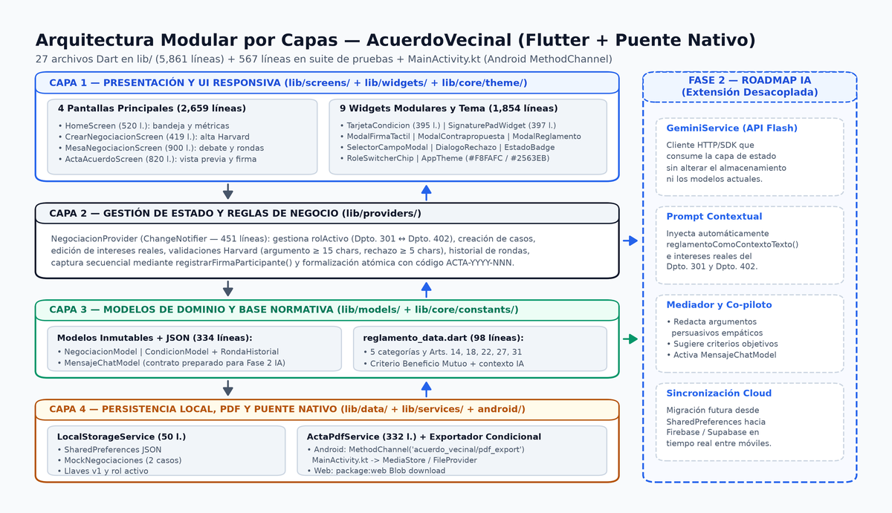

# AcuerdoVecinal


**AcuerdoVecinal** es una aplicación móvil multiplataforma (Android y Web) desarrollada en Flutter para mediar conflictos de convivencia en edificios y condominios mediante el **Método de Negociación de Harvard** y reglas de **narrativa persuasiva constructiva**, culminando en un **Acta de Compromiso Digital en formato PDF A4** con firmas táctiles individuales.

> Proyecto desarrollado en la Universidad Tecnológica del Perú (UTP) para el curso **Negociación y Narrativa** (Fase 1 MVP verificada).

---

## ¿Qué problema resuelve?

Los conflictos cotidianos por ruido nocturno, mascotas, límites de cochera o uso de áreas comunes suelen discutirse en chats informales donde escalan los ataques personales y no queda constancia formal de lo acordado. **AcuerdoVecinal** sustituye ese canal por una mesa estructurada que:

- **Separa a las personas del problema:** apertura neutral por categoría e interruptor opcional de **Modo Anónimo** (`esAnonimo`).
- **Visibiliza intereses reales:** panel bilateral **Intereses Reales (Harvard)** editable por ambas partes (`Dpto. 301` ↔ `Dpto. 402`).
- **Exige narrativa constructiva:** toda oferta o contrapropuesta requiere un **argumento persuasivo** ($\ge 15$ caracteres) y todo rechazo exige un **motivo justificado** ($\ge 5$ caracteres).
- **Ancla en criterios objetivos:** respaldo obligatorio en el Reglamento Interno integrado (`Arts. 14, 18, 22, 27, 31` o *Beneficio Mutuo*).
- **Formaliza con firma segura y PDF nativo:** captura táctil individual en modal sin scroll (`0 px` touch slop), sellado único `ACTA-YYYY-NNN` y exportación PDF en Android (`MediaStore` / `FileProvider`) y Web (`Blob`).

---

## Capturas Reales de la Aplicación

<p align="center">
  
</p>

<p align="center">
  
</p>

<p align="center">
  
</p>

---

## Arquitectura y Flujo Operativo

La aplicación sigue una arquitectura modular en cuatro capas (`Presentación`, `Estado con Provider`, `Dominio y Reglamento`, `Persistencia + Exportación PDF`) con `27` archivos Dart en [`lib/`](lib/) (`5,861` líneas), puente nativo Kotlin en [`MainActivity.kt`](android/app/src/main/kotlin/com/acuerdovecinal/acuerdo_vecinal/MainActivity.kt) (`132` líneas) y suite automatizada en [`test/widget_test.dart`](test/widget_test.dart) (`567` líneas).

<p align="center">
  
</p>

---

## Estructura del Repositorio

```text
AppAcuerdoVecinal/
├── .github/
│   ├── workflows/flutter_ci.yml        # Integración continua (analyze + test)
│   └── PULL_REQUEST_TEMPLATE.md        # Plantilla de revisión para el equipo
├── android/
│   └── app/src/main/kotlin/.../MainActivity.kt  # MethodChannel nativo para PDF
├── docs/
│   ├── images/                         # Capturas reales y diagramas del proyecto
│   ├── ARQUITECTURA.md                 # Diseño por capas, modelos y puente nativo
│   ├── FUNCIONALIDADES.md              # Guía práctica de uso paso a paso
│   └── GUIA_DESARROLLO.md              # Entorno local, depuración y compilación APK
├── lib/
│   ├── core/                           # Constantes del reglamento y tema AppTheme
│   ├── data/                           # SharedPreferences JSON y 2 casos demo semilla
│   ├── models/                         # NegociacionModel, CondicionModel, MensajeChatModel
│   ├── providers/                      # NegociacionProvider (reglas Harvard y turnos)
│   ├── screens/                        # Home, CrearNegociacion, MesaNegociacion, ActaAcuerdo
│   ├── services/                       # ActaPdfService y exportador condicional Android/Web
│   ├── widgets/                        # 9 widgets modulares (TarjetaCondicion, ModalFirmaTactil, etc.)
│   └── main.dart                       # Punto de entrada Material 3 + Provider
├── test/
│   └── widget_test.dart                # 7 pruebas unitarias, PDF y UI móvil (360x780)
├── web/                                # Configuración de ejecución en navegador
├── CHANGELOG.md                        # Historial de versiones
├── CONTRIBUTING.md                     # Flujo de ramas y commits convencionales
└── pubspec.yaml                        # Dependencias del paquete acuerdo_vecinal (1.0.0+1)
```

---

## Inicio Rápido (Entorno Local)

### Requisitos previos
- **Flutter SDK:** `3.50.0` (Dart `^3.14.0`)
- **Android SDK** (`minSdk = 24`) + **JDK 17+** (para compilar APK Android)
- Navegador Chrome/Edge o dispositivo/emulador Android

### Comandos principales

```bash
# 1. Instalar dependencias
flutter pub get

# 2. Verificar análisis estático y pruebas automatizadas
flutter analyze
flutter test

# 3. Ejecutar en navegador web o dispositivo conectado
flutter run -d chrome
flutter run

# 4. Compilar APK Release optimizado por arquitectura
flutter build apk --release --split-per-abi
```

---

## Métricas Verificadas (Fase 1 MVP)

| Indicador | Resultado Verificado |
| :--- | :--- |
| Análisis estático (`flutter analyze`) | `0` problemas (`No issues found!`) |
| Pruebas automatizadas (`flutter test`) | `7 / 7` aprobadas (incluye viewport `360×780 px`) |
| APK Release principal (`arm64-v8a`) | `19.0 MB` (`-87.8 %` frente a `156.0 MB` Debug) |
| APK Release 32-bit (`armeabi-v7a`) | `17.1 MB` (`-89.0 %` frente a Debug) |
| Tree-shaking de fuente `MaterialIcons` | `8,736 B` desde `1,645,184 B` (`-99.5 %`) |

---

## Documentación Detallada

- [Guía práctica de funcionalidades y uso](docs/FUNCIONALIDADES.md)
- [Arquitectura técnica, modelos y puente nativo](docs/ARQUITECTURA.md)
- [Guía de desarrollo para colaboradores](docs/GUIA_DESARROLLO.md)
- [Normas de contribución y flujo Git](CONTRIBUTING.md)
- [Historial de cambios](CHANGELOG.md)
