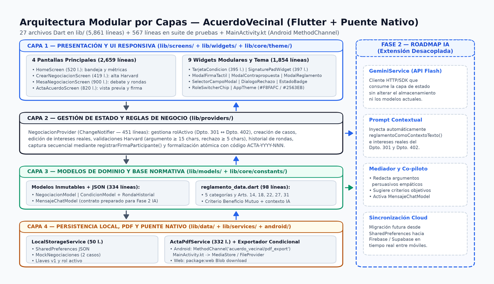

# Arquitectura Técnica de AcuerdoVecinal

**AcuerdoVecinal** (`1.0.0+1`) está construida siguiendo una arquitectura modular por capas desacopladas sobre Flutter y `Provider` (`ChangeNotifier`), compuesta por **27 archivos Dart en `lib/` (`5,861` líneas)**, un puente nativo Android en Kotlin (`132` líneas) y una suite de pruebas automatizadas (`567` líneas).

  

---

## 1. Desglose por Capas

| Capa / Directorio | Archivos Clave | Líneas | Responsabilidad |
| :--- | :--- | :---: | :--- |
| **Entrada y Núcleo** (`lib/`, `lib/core/`) | `main.dart`, `app_theme.dart`, `reglamento_data.dart` | `311` | Arranque Material 3, tokens visuales (`AppColors`) y catálogo normativo de 6 criterios. |
| **Modelos** (`lib/models/`) | `negociacion_model.dart`, `condicion_model.dart`, `mensaje_chat_model.dart` | `334` | Contratos inmutables con `copyWith`/`toJson`/`fromJson`, historial de rondas y stub Fase 2. |
| **Estado** (`lib/providers/`) | `negociacion_provider.dart` | `451` | Fuente única de verdad: ciclo CRUD, reglas Harvard, turnos, firma individual y sellado `ACTA`. |
| **Datos Locales** (`lib/data/`) | `local_storage_service.dart`, `mock_negociaciones.dart` | `155` | Persistencia JSON en `SharedPreferences` y carga inicial de 2 casos semilla. |
| **Servicios PDF** (`lib/services/`) | `acta_pdf_service.dart` + `pdf_export/` (`4` archivos) | `420` | Renderizado vectorial A4 con firmas embebidas y exportador condicional Android/Web. |
| **Pantallas** (`lib/screens/`) | `home`, `crear_negociacion`, `mesa_negociacion`, `acta_acuerdo` | `2,659` | Cuatro vistas responsivas del ciclo completo de mediación. |
| **Widgets** (`lib/widgets/`) | `9` componentes reutilizables | `1,531` | `TarjetaCondicion`, `SignaturePadWidget`, modales táctiles, badges y selector de rol. |
| **Puente Nativo** (`android/.../`) | `MainActivity.kt` | `132` | `MethodChannel('acuerdo_vecinal/pdf_export')` para `MediaStore` y `FileProvider`. |

---

## 2. Modelos de Datos y Persistencia

### `NegociacionModel` (`lib/models/negociacion_model.dart`)
- **Identidad y partes:** `id`, `titulo`, `categoria`, `descripcionProblema`, `dptoSolicitante`, `dptoReceptor`, `esAnonimo`.
- **Núcleo Harvard:** `interesSolicitante`, `interesReceptor`, `condiciones` (`List<CondicionModel>`).
- **Máquina de estados (`EstadoNegociacion`):** `enNegociacion` → `listoParaFirmar` → `formalizada`.
- **Cierre documental:** `fechaCreacion`, `fechaFormalizacion`, `codigoActa` (`ACTA-YYYY-NNN`), `firmadoSolicitante`, `firmadoReceptor`, `firmaSolicitanteBase64`, `firmaReceptorBase64`.

### `CondicionModel` y `RondaHistorial` (`lib/models/condicion_model.dart`)
- Almacena `tituloClausula`, `descripcionPropuesta`, `criterioObjetivo`, `argumentoPersuasivo`, `autorUltimaOferta`, `estado` (`pendiente`, `aceptada`, `rechazada`), `motivoRechazo` e `historial`.

### Llaves de almacenamiento local (`LocalStorageService`)
- `'acuerdo_vecinal_negociaciones_v1'`: arreglo JSON con todas las negociaciones activas y formalizadas.
- `'acuerdo_vecinal_rol_activo'`: último departamento seleccionado (`Dpto. 301` o `Dpto. 402`).

---

## 3. Puente Nativo de Exportación PDF (Android y Web)

En versiones iniciales, librerías externas (`share_plus` y `path_provider_android`) presentaron incompatibilidades bajo ofuscación R8 en compilación Release. Se reemplazaron por un exportador condicional puro en `lib/services/pdf_export/`:

- **Android (`pdf_exporter_mobile.dart` → `MainActivity.kt`):**
  - Canal: `MethodChannel("acuerdo_vecinal/pdf_export")`.
  - `guardarPdfEnDescargas`: utiliza `MediaStore.Downloads` con `IS_PENDING` en Android 10+ (API 29+) o `getExternalFilesDir` en versiones anteriores (`minSdk = 24`).
  - `compartirPdf`: escribe en `cacheDir/actas`, expone una URI segura mediante `androidx.core.content.FileProvider` (`${applicationId}.acta_provider`) y abre `Intent.ACTION_SEND` con `FLAG_GRANT_READ_URI_PERMISSION`.
- **Web (`pdf_exporter_web.dart`):** usa `package:web` (`^1.1.0`) para crear un `Blob` `application/pdf` y disparar la descarga directa en navegador.

---

## 4. Puntos de Extensión Preparados para Fase 2 (IA y Cloud)

1. **Co-piloto Mediador IA:** `MensajeChatModel` (`lib/models/mensaje_chat_model.dart`) y `reglamentoComoContextoTexto()` (`lib/core/constants/reglamento_data.dart`) están listos para inyectar el reglamento e intereses reales a un futuro `GeminiService` (Gemini Flash API) sin modificar el modelo actual.
2. **Sincronización en tiempo real:** reemplazar `LocalStorageService` detrás de `NegociacionProvider` por Firebase o Supabase permitirá salas compartidas por código QR entre dos dispositivos independientes.
