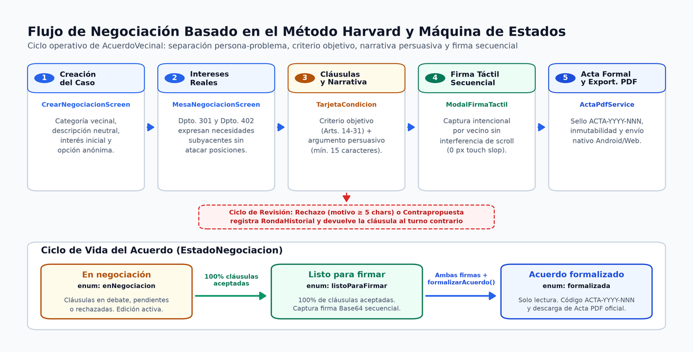

# Funcionalidades y Guía Práctica de Uso

Esta guía describe paso a paso cómo operar **AcuerdoVecinal** desde la perspectiva de los dos departamentos simulados en Fase 1 (`Dpto. 301` y `Dpto. 402`), así como las validaciones que garantizan una negociación constructiva.

---

## Flujo Completo de Negociación

  

---

## 1. Bandeja Principal y Cambio de Rol (`HomeScreen`)

- **Pestañas de estado:** separa los casos en **Activos** (`enNegociacion` y `listoParaFirmar`) y **Formalizados** (`formalizada`).
- **Filtros y búsqueda:** permite filtrar por `Todas`, `Ruido`, `Mascotas`, `Cochera`, `Áreas Comunes` u `Otros`, además de buscar por título o descripción.
- **Conmutador de rol (`RoleSwitcherChip`):** ubicado en la barra superior (`Soy: Dpto. 301` ↔ `Soy: Dpto. 402`). Permite probar el intercambio bilateral completo desde un único dispositivo.
- **Datos de demostración:** en el primer arranque `MockNegociaciones` precarga dos casos realistas:
  1. *Volumen de música y ensayos nocturnos* (`enNegociacion`, con 1 condición pendiente y 1 rechazada).
  2. *Uso del límite de cochera sótano 1* (`listoParaFirmar`, con 2/2 condiciones aceptadas y lista para firmar).
  - Desde el menú superior (`⋮`) puedes restaurar los casos semilla en cualquier momento.

---

## 2. Creación de un Nuevo Caso (`CrearNegociacionScreen`)

El formulario guía al solicitante en tres tarjetas estructuradas:

1. **Datos del Conflicto:** título breve, categoría, descripción fáctica y activación opcional de **Modo Anónimo** (`esAnonimo`), que oculta el departamento solicitante frente a su contraparte al abrir conflictos sensibles.
2. **Tu Interés Real (Harvard):** campo obligatorio para explicar *qué necesidad buscas proteger* (descanso, seguridad, acceso) en lugar de imponer una exigencia rígida.
3. **Primera Condición y Argumento Persuasivo:**
   - Título de la cláusula ($\ge 4$ caracteres) y propuesta concreta ($\ge 10$ caracteres).
   - **Criterio Objetivo:** seleccionado mediante `SelectorCampoModal` entre los 6 ítems del Reglamento Interno.
   - **Argumento persuasivo:** mínimo **`15` caracteres** justificando el beneficio compartido.

---

## 3. Mesa de Negociación Bilateral (`MesaNegociacionScreen`)

- **Intereses Reales (Harvard):** bloque superior que muestra simultáneamente el interés del solicitante y del receptor. Cada vecino puede editar únicamente su propio interés mientras el caso siga abierto.
- **Control estricto de turnos:** en cada `TarjetaCondicion`, la parte que emitió la última oferta (`autorUltimaOferta`) espera la evaluación de su contraparte.
- **Acciones disponibles para quien responde:**
  - **Aceptar:** marca la cláusula como `aceptada`. Si todas alcanzan este estado, el caso pasa automáticamente a `listoParaFirmar`.
  - **Rechazar (`DialogoRechazo`):** exige un motivo claro de mínimo **`5` caracteres** para orientar la reformulación.
  - **Contraofertar (`ModalContrapropuesta`):** edita propuesta, criterio objetivo y argumento persuasivo, archivando automáticamente la versión previa en `historial` (`RondaHistorial`).
- **Consulta rápida del Reglamento (`ModalReglamento`):** accesible desde el icono de libro en la barra superior con los artículos `14`, `18`, `22`, `27`, `31` y el *Criterio de Beneficio Mutuo / Buena Convivencia*.

---

## 4. Firma Táctil Secuencial y Acta PDF (`ActaAcuerdoScreen`)

1. **Firma centrada en un vecino:** el sistema verifica el `rolActivo` y muestra únicamente el botón para ese participante (`Firmar como Dpto. 301` o `Firmar como Dpto. 402`).
2. **Modal táctil aislado (`ModalFirmaTactil`):** abre un diálogo sin desplazamiento vertical con `SignaturePadWidget` (`OneSequenceGestureRecognizer` con `0 px` de tolerancia de desplazamiento) para evitar líneas accidentales al hacer scroll. Exige marcar la casilla de consentimiento antes de confirmar.
3. **Sellado automático (`registrarFirmaParticipante`):** cuando firman ambos departamentos, se asigna el código correlativo `ACTA-YYYY-NNN` (por ejemplo, `ACTA-2026-001`), se guarda `fechaFormalizacion` y el caso queda bloqueado en modo solo lectura.
4. **Exportación PDF A4 (`ActaPdfService`):** genera un documento A4 vectorial con partes intervinientes, intereses conciliados, cláusulas aprobadas y ambas firmas embebidas, listo para **Guardar PDF** o **Compartir** en Android y descargar en Web.
